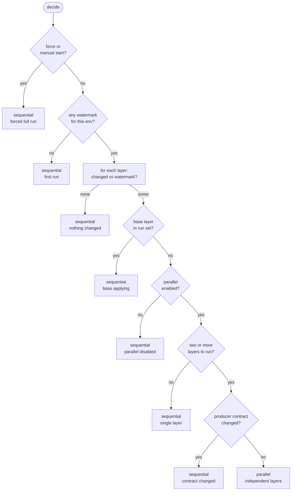

# layered-terraform-pipeline

A CodePipeline that deploys layered Terraform to a promotion chain of AWS accounts,
running only the layers that actually changed, in the only order that is safe.

## Topology

Stages are generated from the environment list. For dev, staging and prod that is
21 stages — CodePipeline allows 50, which is what the validation on
`intermediate_environments` protects.

```
source                          CodeConnection or CodeCommit, CODEBUILD_CLONE_REF
route                           CodeBuild on Lambda compute; exports PLAN and MODES

--- direct-apply environments (dev) ---
dev-network                     skip unless PLAN contains ,dev/network,
dev-parallel                    skip unless MODES contains ,dev/parallel,
dev-databases                   skip unless MODES sequential AND PLAN contains the layer
dev-services                    "

--- inter-environment approval ---
approve-staging                 skip unless staging has any work

--- direct-apply environments (staging) ---
staging-network                 skip unless PLAN contains ,staging/network,
staging-parallel                skip unless MODES contains ,staging/parallel,
staging-databases               skip unless MODES sequential AND PLAN contains the layer
staging-services                "

--- inter-environment approval ---
approve-production              skip unless production has any work

--- production (sequential plan -> approve -> apply per layer) ---
prod-plan-network               plan network
prod-approve-network            manual approval before apply
prod-apply-network              apply using saved plan
prod-plan-databases             plan databases (after network applied)
prod-approve-databases          manual approval
prod-apply-databases            apply using saved plan
prod-plan-services              plan services (after databases applied)
prod-approve-services           manual approval
prod-apply-services             apply using saved plan
```

All environments except the last (production) apply directly with no plan or approval
stage. The last environment gets sequential per-layer plan → approve → apply, so each
layer is planned, manually reviewed, and applied before the next layer begins.

With `enable_manual_approvals = false` every approval disappears — the inter-environment
`approve-staging` / `approve-production` stages and the production per-layer
`prod-approve-*` stages — so each production layer runs **plan → apply** and the chain
runs start to finish without a human in the loop. See
[Disabling manual approvals](#disabling-manual-approvals).

## How stages skip themselves

CodePipeline has no cross-stage DAG, so branching is expressed as a linear chain of
mutually exclusive stages. Each generated stage carries:

```hcl
before_entry {
  condition {
    result = "SKIP"
    rule { … provider = "VariableCheck" … }
  }
}
```

`SKIP` supports only the `VariableCheck` and `LambdaInvoke` rules, and a `SKIP`
condition cannot be overridden from the console. Multiple rules in one condition are
ANDed. A skipped stage reports as **Skipped** with its actions as **Didn't Run**, and
costs roughly zero seconds — which is why a chain of skips is an acceptable
substitute for real branching.

The two variables the router publishes:

```
PLAN   ,dev/network,dev/databases,prod/services,     what to run, per environment
MODES  ,dev/sequential,staging/parallel,             how to run it, per environment
```

Both names are static, which is what lets `buildspecs/route.yml` be an ordinary file
in the repository rather than something generated by Terraform.

## Ordering rules

Implemented in `buildspecs/scripts/route.py`, covered by `buildspecs/scripts/test_route.sh`
(`make test` also runs `test_plan_apply.sh`, which covers `plan.sh`/`apply.sh`):



- **The base layer applying forces a sequential run.** Any change to `network` can
  shift the values its consumers read without touching `network/outputs.tf` — adding
  an availability zone changes the subnet maps. An interface-file check is not safe
  for the layer at the bottom of the stack.
- **Two or more dependent layers may run in parallel**, unless one of them changed
  its contract file (`<layer>/outputs.tf`), in which case producers must go first.
- **Changes to shared files run every layer, fully sequential**: `Makefile`,
  `buildspecs/`. The shared flag is environment-wide — even if a previous run
  applied the shared change to some layers and not others, the whole
  environment runs in dependency order instead of letting the rest catch up in
  parallel.
- **Markdown anywhere is ignored.** A `*.md` file is documentation even inside a
  layer folder.
- **Unrecognised paths are ignored.** Only layer folders, the shared paths and
  `buildspecs/` drive the pipeline; users may keep arbitrary files and folders
  in the repository without triggering it. The webhook's file-path filter stops
  the pipeline for these; the router repeats the rule as a fallback when a push
  gets through (it can also contain a real change).
- **A full run bypasses all of the above.** A manual **Release change** — or
  `FORCE_MODE=full-sequential` — runs every layer in every environment,
  sequentially, before any change detection runs. The webhook's file-path
  filter only gates automatic pushes; it cannot stop a manual start.

## Per-environment watermarks

A **watermark** is the git commit SHA of the last successful apply for a given
environment and layer. It is stored as an SSM parameter and written by the apply
step after a successful run. The router compares the current HEAD against each
layer's watermark to decide what needs to run — if a layer is already at the
same commit, it is skipped.

Each layer records its own watermark:

```
/pipeline/<workload>/<env>/<layer>/last-applied-commit      (in the CI/CD account)
```

The router diffs against **each layer's own watermark, per environment**. Comparing
against the previous pipeline run instead would be wrong, because a run can succeed
for one layer and fail for another, and prod is routinely several commits behind dev.

The diff is **content-based, not history-based**: the router runs
`git diff --name-only <watermark> <HEAD>`, which lists only files whose bytes
differ at the two endpoints. Watermarks are written on success only, so the
router has no memory of failed attempts — a layer is skipped whenever its files
are identical at its watermark and at HEAD, even if an intermediate commit
changed those files and its apply failed. That is safe because the live
infrastructure already matches the desired state at HEAD; a failed apply is
retried only when the layer's files actually differ from the last success. Use a
manual **Release change** or `FORCE_MODE=full-sequential` to force every layer to
re-run regardless of the diff.

Watermarks live in the CI/CD account so the router needs no cross-account access to
decide anything. The apply step writes its watermark after clearing the assumed
target-account credentials, which restores the build's own identity.

## Only the approved plan is applied

Plans go to the state bucket in the target account:

```
s3://terraform-state-<account_id>/<workload>/_plans/<environment>/<layer>/<execution-id>.tfplan
```

Four independent guarantees, strongest first:

1. **Terraform refuses a stale plan.** A saved plan records the state serial it was
   created against; if the state moved, `apply` errors out. Free, and the one that
   matters most.
2. **The key includes the execution ID**, so a queued execution cannot overwrite a
   plan awaiting approval. Relevant because the pipeline runs in `QUEUED` mode.
3. **The SHA-256 recorded at plan time is re-verified** before applying.
4. **Same source artefact**, same execution, and each layer's `.terraform.lock.hcl`
   is committed, so code and provider versions are identical between plan and apply.

The plan action carries a namespace, so the plan stage's rendered summary
(`PLAN_SUMMARY`) is surfaced in the approval message (`Approve plan for …` /
`Rollback: …`). The approve stage shares its plan stage's skip condition, so it
only ever runs after a plan that succeeded in the same execution — the namespace
reference cannot dangle.

## Disabling manual approvals

Set `enable_manual_approvals = false` to run the pipeline end-to-end with no human
gate. This is meant for early project phases where you want the full
routing/plan/apply machinery but do not want to sit on approvals.

What changes:

- **Main pipeline.** The inter-environment promotion approvals (`approve-staging`,
  `approve-production`) are removed, and the production environment drops its
  per-layer `prod-approve-*` stages, leaving **plan → apply** per layer. The saved-plan
  flow is unchanged: the plan produced in the plan stage is still uploaded, digest-verified,
  and applied by the apply stage — there is just no approval step in between.
- **Rollback pipeline.** Each layer's `prod-approve-*` stage is removed, leaving
  **plan → apply** per layer in reverse dependency order.
- **Triggers are unchanged.** The GitHub `trigger` block and the CodeCommit
  EventBridge rule exist in every mode, independent of `enable_manual_approvals`,
  and the source action's `DetectChanges` is always `false` (the branch-filtered
  trigger is the change detection). A push to the configured branch starts the
  pipeline even when a run flows straight through to production. The rollback
  pipeline is always manual-only regardless of this value, because it has no
  trigger block and `DetectChanges` is always `false`.

Everything else — routing decisions, per-environment watermarks, parallel direct-apply
stages, plan/apply buildspecs — is identical in both modes.

## Identity

| Role | Created when | Purpose |
|---|---|---|
| CodePipeline service role | `codepipeline_role_arn = null` | orchestration |
| CodeBuild service role | `codebuild_role_arn = null` | runs route, plan, apply; assumes into targets |
| `cicd-deployer` | `create_deployment_roles = true` | the identity Terraform runs as |

**Hub mode (default).** Set both role ARNs from the `cicd-base` hub outputs, leave
`create_deployment_roles = false`, and the pipeline assumes
`arn:aws:iam::<account_id>:role/cicd-deployer` in each target account. That role name
is an architectural constant of `cicd-base` in spoke mode.

**Self-contained deployment.** Leave the role ARNs null and set
`create_deployment_roles = true`. The module creates the pipeline, both service roles
and the deployer role in the current account. This is the configuration where
pipeline, workload and state bucket all live together — useful for a fast standalone
setup, and it is a supported capability, not a test mode. A precondition enforces
that every environment points at the current account, because Terraform can only
create the role where its provider is pointed.

No backend or provider block anywhere contains `assume_role`. The build assumes the
deployer role and exports credentials to the environment, which is what lets a
developer run the identical `make plan` under their own credentials.

Both service roles grant `UseConnection` on the configured connection, scoped by
`codeconnections:FullRepositoryId` and `codeconnections:ProviderAction` so the
connection cannot reach repositories other than `repository_id`. The CodeBuild
role may only run `GitPull` (what its git clones use); the pipeline role may only
run `GetBranch`, `GetCommit` and `GenerateReferenceLink` (what the source stage
uses). `codeconnections:BranchName` is deliberately not used: git protocol
requests and `GetCommit`/`GenerateReferenceLink` carry no branch name, so the
condition would deny the very operations the pipeline depends on.

The CodeBuild role also gets `codebuild:CreateReportGroup` / `CreateReport` /
`UpdateReport` / `BatchPutTestCases` scoped to `report-group/<pipeline_name>-*`, for the
`layer-status` JUnit reports the plan/apply buildspecs upload. Report files are published
even when the build phase fails, so a failed layer's summary survives in CodeBuild's
Reports UI — the one failure channel that does (see DESIGN.md, "Failure visibility").

## Compute

| Project | Environment type | Why |
|---|---|---|
| route | `ARM_LAMBDA_CONTAINER` / `BUILD_LAMBDA_1GB` | starts in about a second; the curated Lambda images include git and the AWS CLI |
| plan, apply | `ARM_CONTAINER` / `BUILD_GENERAL1_SMALL` | Terraform writes outside `/tmp` and can exceed Lambda's 15 minute ceiling; ARM is cheaper and sufficient |

Three CodeBuild projects in total, no matter how many environments or layers exist:
everything that varies is passed as action-level environment variables. Adding an
environment creates no new build projects.

Lambda compute is not available in every Region. Where it is not, set:

```hcl
route_compute = {
  environment_type = "ARM_CONTAINER"
  compute_type     = "BUILD_GENERAL1_SMALL"
  image            = "aws/codebuild/amazonlinux2-aarch64-standard:4.0"
}
```

A validation rejects Lambda compute for `terraform_compute`.

## Notes on choices that are not obvious

**`execution_mode = "QUEUED"` is not optional.** The default, `SUPERSEDED`, cancels
an in-flight execution when a new commit lands, which can abandon a run part-way
through a layer. `PARALLEL` would run concurrent applies against the same state.

**`OutputArtifactFormat = "CODEBUILD_CLONE_REF"` is required.** The default zip
artefact has no `.git` directory, so change detection would be impossible. The clone
delivered through `CODEBUILD_CLONE_REF` carries the full history, so the diff base
can be many commits back.

**The trigger filters by file path as a guard, not a router.** Only changes to
layer folders, the root `Makefile`, and `buildspecs/` start the pipeline; `.md`
files anywhere and `cicd/` do not, so a documentation-only push consumes no
build at all. The filter cannot route per layer (filters are pipeline-wide and
compare against the previous push), so the router still makes the per-layer
decision with better information: each layer's own watermark, per environment.

**CodeCommit gets an EventBridge rule.** V2 pipeline `trigger` blocks only support
`CodeStarSourceConnection`. The alternative, `PollForSourceChanges`, is slower and
counts against a separate account quota.

**The routing step is a CodeBuild project, not a `Commands` action.** `Commands`
accepts only `LINUX_CONTAINER` and `WINDOWS_SERVER_2022_CONTAINER`, so it cannot use
Lambda compute.

## Rollback pipeline

The module also creates `${var.workload}-rollback-production-infrastructure`,
a separate CodePipeline that targets only the production environment and is
never triggered by a push.

### How it works

1. Open the rollback pipeline in the CodePipeline console.
2. Press **Release change** and set the `TARGET_COMMIT` pipeline variable to
   the commit SHA you want to roll back to (in the **Variables** section of
   the release dialog). An empty value is **refused by the build scripts**: the
   first layer's build fails with a descriptive error instead of running at
   branch HEAD, because a deployment at HEAD is not a rollback.
3. The pipeline runs per-layer **plan → approve → apply** in **reverse dependency
   order** (`services` first, then `databases`, then `network`). Each layer is
   planned, manually approved, and applied before the next layer begins.
4. Layers run in reverse because the base layer (VPC) cannot be destroyed while
   dependent resources still exist in it — the last layer must go first.

**Do not use the source version override** — CodeStarSourceConnection does
not reliably check out a specific commit when overridden. Instead, the pipeline
always checks out the branch HEAD, and the build scripts switch to
`TARGET_COMMIT` explicitly via `git fetch && git checkout`.

The rollback commit defines the desired state. Terraform reconciles the live
infrastructure to match it, which includes destroying resources that were added
after that commit.

### Stages

```
source                           branch HEAD (TARGET_COMMIT is checked out by the build)
<prod>-plan-services             plan services at TARGET_COMMIT
<prod>-approve-services          manual approval
<prod>-apply-services            apply using saved plan
<prod>-plan-databases            plan databases at TARGET_COMMIT
<prod>-approve-databases         manual approval
<prod>-apply-databases           apply using saved plan
<prod>-plan-network              plan network at TARGET_COMMIT
<prod>-approve-network           manual approval
<prod>-apply-network             apply using saved plan
```

### What is different from the main pipeline

| Aspect | Main pipeline | Rollback pipeline |
|---|---|---|
| Trigger | push to branch | manual only (console) |
| Environments | dev, staging, prod | production only |
| Routing | route step decides what runs | all layers always run |
| Layer order | forward (network → databases → services) | reverse (services → databases → network) |
| Commit | HEAD of the branch | `TARGET_COMMIT` variable |
| How commit is applied | source action checks it out | `git checkout` in build script |

### IAM

The rollback pipeline reuses the same CodePipeline service role and the same
CodeBuild projects as the main pipeline, so no additional IAM resources are
created.

## Repository contract

This module drives the repository through its Makefile. The repository must provide
`Makefile` (targets `plan`, `apply`, `apply-plan`, `show-plan`, each taking `ENV` and
`LAYER`), `buildspecs/scripts/route.py`, `buildspecs/scripts/ci-setup.sh`,
`buildspecs/scripts/plan_summary.py`, and `buildspecs/{route,plan,apply}.yml`.
Relocate the buildspecs with `buildspec_prefix`.

## Inputs worth knowing

| Name | Default | Notes |
|---|---|---|
| `layers` | `["network","databases","services"]` | first entry is the base layer |
| `enable_parallel_layers` | `true` | adds one stage per environment |
| `enable_manual_approvals` | `true` | `false` removes every approval; the push triggers are independent of this value (see [Disabling manual approvals](#disabling-manual-approvals)) |
| `terraform_version` | `1.15.3` | installed and checksum-verified by the buildspecs |
| `deployer_role_name` | `cicd-deployer` | matches `cicd-base` spoke mode |
| `state_bucket_prefix` | `terraform-state` | bucket is `<prefix>-<account_id>` |
| `plan_prefix` | `_plans` | inside the state bucket |
| `watermark_prefix` | `/pipeline` | SSM prefix in the CI/CD account |
| `approval_sns_topic_arn` | `null` | optional notification on approvals |

`stage_names` is exported as an output — check it after a plan to confirm the
generated topology before applying.
